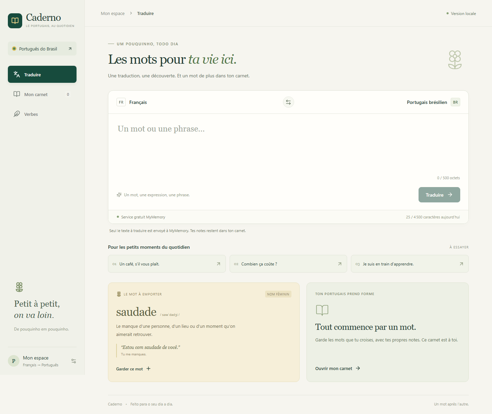
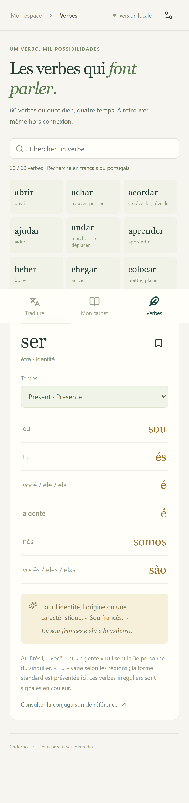

# Caderno

**Everyday Portuguese, one word at a time.** A personal language notebook that brings French–Brazilian Portuguese translation, vocabulary notes and verb conjugations into one calm, mobile-friendly interface.

A personal project by [BoooJ](https://github.com/BoooJ), inspired by a practical need while living in Brazil: keeping useful words beyond the moment of translation.



## At a glance

- **Problem:** translations, vocabulary notes and conjugations were scattered across separate tools.
- **Solution:** a responsive web app with a persistent notebook, searchable verbs and offline reading.
- **Delivered:** bidirectional translation, editable vocabulary cards, favorites, flashcards, 60 built-in verbs and custom verb imports.
- **Stack:** React 19, TypeScript, Vite, Express 5, SQLite, Node.js 24 and Docker.
- **Project ownership:** product idea, use-case definition, priorities and iterative feedback. Implementation, testing and deployment were developed with AI coding assistance. This is a personal product project, not a claim of unaided implementation.

## The user journey

1. Translate a word or phrase between French and Portuguese.
2. Explore synonyms and bilingual examples when available.
3. Save a vocabulary card and add personal notes.
4. Look up a verb and switch between conjugation tenses.
5. Review saved cards or export the notebook as JSON.



*Screenshots show the October 2026 local application without a personal notebook. The product interface is intentionally French and Portuguese; this repository documentation is in English. Mobile emulation is not a substitute for testing on a physical iPhone.*

## Product and engineering decisions

| Decision | Why it matters |
| --- | --- |
| Bottom navigation on mobile | Keeps the three main tasks within easy reach |
| One conjugation tense at a time | Avoids wide tables on a small screen |
| Persistent translation cache | Reuses results and reduces provider quota consumption |
| Stored conjugations rather than generated forms | Makes saved verb forms immediately available |
| Independently loaded learning context | Keeps the translation usable if an examples provider fails |
| Version checks on notebook updates | Detects conflicting edits from different devices |
| JSON import and export | Gives users portable copies of their vocabulary |

## Architecture

```text
React / TypeScript / PWA
          | HTTP API
Express / Node.js 24
          +-- SQLite: entries, verbs, caches and quotas
          +-- MyMemory: translation
          +-- Tatoeba: bilingual examples
          +-- Sinonimos / Conjugacao: language references
```

Previously loaded notebook entries and conjugations can be read offline. Translation, new imports and edits require a connection. Offline write synchronization is not implemented.

## Run locally

Requirements: **Node.js 24** and npm.

```sh
npm ci
npm run dev
```

Open `http://localhost:5173`. Local development is unauthenticated and bound to loopback addresses. Do not expose the development server to the Internet.

To try the production build and offline behavior, stop the development server first, then run:

```sh
npm run build
npm start
```

Open `http://localhost:3090`. Local data is created in `data/`, which is excluded from version control.

## Verification

```sh
npm test
npm run build
npx playwright install chromium webkit
npm run test:ui
npm run test:pwa
```

The suites cover CRUD operations, concurrent edits, import/export, authentication, provider quotas and failures, verb data, browser journeys and offline reading. GitHub Actions runs the unit/API tests and production build; browser suites can be run separately.

## Deployment and privacy

Designed for a personal VPS deployment using Docker, SQLite and an HTTPS reverse proxy. See the [deployment guide](docs/DEPLOYMENT.md).

Translation input is sent to MyMemory. Additional language searches contact their respective providers. Personal notes are not sent to the translation service. Offline reading stores a browser-side copy of the notebook, cleared on explicit logout.

This repository contains no production credentials, server address or personal database. The live personal instance is not presented as an unrestricted public demo.

## Current scope

Version **0.2.0**. This is a personal, single-user application. It does not yet include an AI coach, spaced repetition, multiple accounts or offline editing. Automated translations can be imperfect; enrichment depends on external services. Custom verb imports require supported simple infinitives and complete reference tables.

Possible next steps include spaced repetition, notebook-based exercises, learning progress tracking and broader testing on real devices. These are future ideas, not shipped features.

## Sources and attribution

- [MyMemory](https://mymemory.translated.net/doc/spec.php): machine translation.
- [Tatoeba](https://tatoeba.org/en/terms_of_use): bilingual examples; authors, source links and licenses are retained in the application.
- [Conjugacao](https://www.conjugacao.com.br/): conjugation references, with source links associated with verbs.
- [Sinonimos](https://www.sinonimos.com.br/): synonyms.

Third-party libraries and content retain their respective terms and licenses. This repository does not claim a blanket redistribution license for external resources.

See [release verification notes](docs/VERIFICATION.md) for publication checks and dependency limitations.
